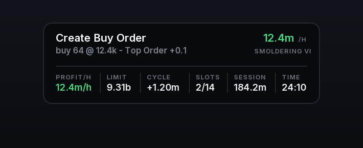

# BzAssist

A Hypixel SkyBlock **bazaar flipping assistant** for Fabric. It reads the live order book, tells you
which flip is the most profitable right now, and then walks you through placing it: one highlighted
slot, one step at a time, with the quantity and the price already filled in.

It does **not** click for you. There is no auto-clicking, no packet sending and no macroing — you click
what is highlighted. That is deliberate: it keeps your account safe and keeps you in control.

* Minecraft 26.2 · Fabric Loader 0.20.1+ · Fabric API · Java 25 · client side only

## What it does

- **Ranks flips** from the live bazaar: half-spread pricing one tick in front of the book, tax-aware
  margin, flow and book-depth filters, and a 15B daily order-value model that charges every placement
  and every relist.
- **Guides the clicks**: `/bzassist plan <item>` highlights the exact slot for each step — create the
  buy order, open `Custom Amount` (the sign is pre-filled with the amount), pick `Top Order +0.1`,
  confirm; then claim, `Create Sell Offer`, `Best Offer -0.1`, confirm.
- **Runs a session** (F6): scans `/managebazaarorders`, finds orders that have been outbid or undercut,
  decides whether relisting is worth the limit it costs, collects the stash, lists what has filled, and
  places the next order.
- **Shows a HUD**: one wide rounded card at the top centre with the current step, profit per hour, and
  a six-column row of `PROFIT/H  LIMIT  CYCLE  SLOTS  SESSION  TIME`. Only on SkyBlock, and only while
  there is a step.

## Install

1. Install [Fabric Loader](https://fabricmc.net/use/) for Minecraft 26.2 and put
   [Fabric API](https://modrinth.com/mod/fabric-api) in your `mods` folder.
2. Drop `bzassist-<version>.jar` into the same `mods` folder.
3. Launch the game. Join Hypixel, and the panel appears once you are in SkyBlock.

The mod is client side: it works on any server and does not need to be installed server-side. It only
acts on Hypixel SkyBlock.

## Use

| Key / command | What it does |
| --- | --- |
| `F6` | start / stop the flipping session (unbound by default — set it in Options → Controls) |
| `/bzassist best [n]` | top flips: profit/h, profit per cycle, limit/h, how long the cap lasts, return per limit coin |
| `/bzassist plan <item>` | start guiding one product |
| `/bza <item>` | same as `plan`, with tab completion |
| `/bzassist price <item>` | one product in full detail: both sides, flow, the per-placement limit arithmetic |
| `/bzassist profile` | purse, inventory, tax, order slots, limit remaining, data age |
| `/bzassist orders` | every order row the reader parsed, its price, and why it is or is not relisted |
| `/bzassist relist` | read the orders, relist what is behind the book, then stop (nothing is bought or sold) |
| `/bzassist dump` | everything the screen scanner currently sees (for bug reports) |
| `/bzassist session` | where the last session report was written |
| `/bzassist daily [reset]` | daily order-value limit spent and left, and when it rolls over |
| `/bzassist selftest` | check the coin parsing and formatting the rest of the mod depends on |
| `/bzassist debug` | toggle `config/bzassist/debug.jsonl` (off by default) |
| `/bzassist refresh` | fetch the bazaar immediately |
| `/bzassist off` | toggle the HUD |
| `/bzassist stop` | clear the plan |
| `/bzassist start` / `end` | start / stop the session without the keybind |

### The HUD

One wide card at the top centre, and only on Hypixel SkyBlock and only while there is a step to do:

- **top row** — what to click in 11 px white, with the profit figure right-aligned in green and a small
  tracked `/H` after it;
- **second row** — the detail (quantity, price) and the item name as a tracked small-caps label;
- **divider**, then **six columns in one row** separated by hairlines:
  `PROFIT/H  LIMIT  CYCLE  SLOTS  SESSION  TIME`, each a tracked label over its value.

`SLOTS` is order slots, not inventory: it reads `2/14` while a session is running (orders found by the
last scan over the slots your Bazaar Flipper tier allows) and `14` when idle.

Type is vanilla-sized (11 px instruction, 8.5 px detail, 9.5 px values, 6.5 px all-caps labels with
0.5 px of letterspacing). The card is a real 8 px rounded rectangle at 97% opacity with a 1 px
`#262A30` border; the instruction turns amber when the step needs a right click.

Motion:

- **start / stop** — the whole card fades and rises 6 px in when a session starts, and fades out when it
  stops;
- **step change** — the old instruction, detail and item name fade out and drift 2 px up while the new
  ones fade in from 2 px below, with the width easing to the wider of the two so nothing jumps;
- **always** — the outlined slot breathes on a 1.8 s sine.



The preview is drawn from the same geometry, palette and type sizes as `AssistOverlay`.

### Session reports

Every session writes a full report to `config/bzassist/sessions/<date>-<time>.log`, streamed while it
runs (a crash still leaves it on disk) and closed with a summary. It records the configuration and
profile at start, every phase change, every instruction the guide issued, every container the scanner
recognised, every chat line received, the bazaar feed's updates and failures, a state sample every five
seconds, and every exception the mod caught. `/bzassist session` prints the path.

If a session does something strange, that file replays exactly what the mod thought was happening.

## Configuration

`config/bzassist.properties` is created on first launch; every value is clamped to a sane range.

| Key | Default | Meaning |
| --- | --- | --- |
| `poll_interval_ms` | `5000` | how often to fetch the bazaar (the API itself changes every ~20 s) |
| `tax_percent` | `1.25` | bazaar sell tax: 1.25 without Bazaar Flipper, 1.125 at I, 1.0 at II |
| `order_slots` | `14` | simultaneous orders: 14, 21 (Flipper I) or 28 (Flipper II) |
| `max_fill_hours` | `72` | orders expected to fill slower than this are not sized into |
| `cache_buster` | `false` | add a changing query parameter to defeat CDN caching |
| `overlay` | `true` | show the HUD and the slot highlight |
| `debug` | `false` | write every bazaar screen to `config/bzassist/debug.jsonl` |

Tax and order slots are also read from the bazaar GUI when you open it, and the tax is written back.

## Build from source

```bash
./gradlew build        # jar in build/libs/bzassist-<version>.jar
./gradlew runClient    # launch Minecraft 26.2 with the mod loaded
./gradlew runServer    # launch a dedicated test server
```

The first build downloads Gradle, Loom, Minecraft 26.2 and the assets into `~/.gradle`.

Releasing is a version bump: raise `version` in `gradle.properties`, add a `## [x.y.z]` section to
`CHANGELOG.md`, and push to `main`. If that version has no release yet, the release workflow builds the
jar and publishes it with that changelog section as the notes. Pushing a tag `v<x.y.z>` does the same,
and refuses a tag that disagrees with `gradle.properties`. Every push also runs a build
(`.github/workflows/build.yml`).

## Troubleshooting

| Symptom | Cause and fix |
| --- | --- |
| no HUD and `/bzassist best` says no data | you are not on Hypixel SkyBlock, or the fetch failed — `/bzassist profile` shows the error and the data age |
| the half-filled marker moves but no strategy appears | the HUD is off (`/bzassist off`) or there is no plan (`/bzassist plan <item>`) |
| `F6` does nothing | it is bound to `F6` by default; rebind it in Options → Controls → BzAssist |
| HUD says "Daily limit reached" | the cap is gone until 00:00 UTC (7pm EST); `/bzassist daily reset` clears it by hand |
| a step highlights the wrong slot | run `/bzassist dump` and open an issue with that output — the lore strings are the one thing not yet pinned against the live game |
| numbers look stale | `/bzassist refresh`, and check `poll_interval_ms` |

## Documentation

- [docs/bazaar.md](docs/bazaar.md) — the measured API facts, the price-field trap, the daily-limit model,
  sizing and ranking, and what is still unverified against the live game.
- [docs/fonts.md](docs/fonts.md) — the FreeType text renderer and why MSDF was dropped.
- [docs/improvements.md](docs/improvements.md) — the roadmap: what to build next, in order, with effort.
- [docs/testing.md](docs/testing.md) — a step-by-step checklist that exercises every feature.
- [docs/data-requirements.md](docs/data-requirements.md) — every screen title, slot label, lore line and
  chat line the mod depends on, and the one file that captures them all.
- [CHANGELOG.md](CHANGELOG.md) — what changed, and the known limitations of this release.

## Layout

```
src/main/java/dev/bzassist/BzAssist.java           common entrypoint, MOD_ID, MOD_VERSION, logger
src/client/java/dev/bzassist/client/               client entrypoint, HUD, commands, text renderer
src/client/java/dev/bzassist/client/bazaar/        API client, flip engine, guide, session, screen reader
src/main/resources/fabric.mod.json                 mod metadata
src/main/resources/assets/bzassist/                icon and bundled Inter SemiBold
```

## License

CC0-1.0. The bundled Inter font is under the SIL Open Font License, see `tools/fonts/OFL.txt`.

BzAssist is not affiliated with Hypixel or Mojang.
